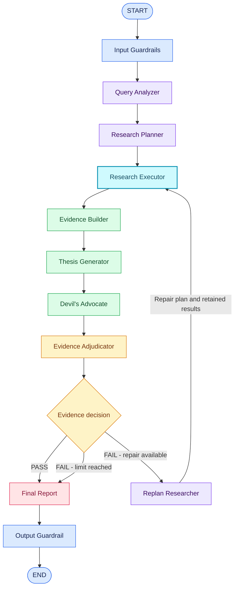
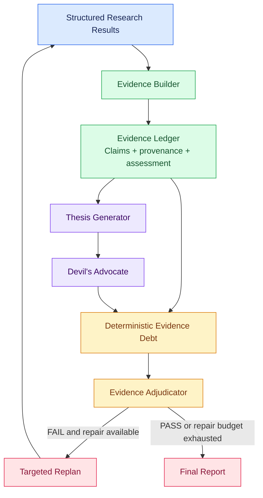
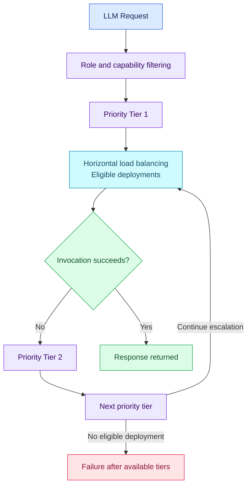
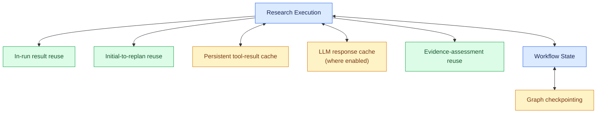

# QuantPilot
### Evidence-Grounded Quantitative Research & Market Intelligence

**QuantPilot** is a modular, multi-agent financial research system that converts natural-language questions into structured investigations across market data, financial metrics, quantitative analysis and external research.

Rather than stopping at tool retrieval or a single LLM-generated answer, QuantPilot builds an evidence ledger, generates and challenges a research thesis, evaluates evidence sufficiency and can perform a targeted, bounded research-repair cycle before producing a structured report.

> **Project scope:** QuantPilot is a research and analytical agent—not an autonomous trading bot. It does not execute trades or make investment decisions on the user's behalf.

---

## Table of contents

- [1. Motivation and objectives](#1-motivation-and-objectives)
- [2. Capabilities and research use cases](#2-capabilities-and-research-use-cases)
- [3. System architecture](#3-system-architecture)
- [4. Research lifecycle](#4-research-lifecycle)
- [5. Evidence, adjudication and adaptive repair](#5-evidence-adjudication-and-adaptive-repair)
- [6. LLM Gateway and reliability](#6-llm-gateway-and-reliability)
- [7. Persistence and incremental execution](#7-persistence-and-incremental-execution)
- [8. Engineering contributions and practical value](#8-engineering-contributions-and-practical-value)
- [9. Evaluation methodology and results](#9-evaluation-methodology-and-results)
- [10. Limitations and interpretation](#10-limitations-and-interpretation)
- [11. Technology stack](#11-technology-stack)
- [12. Repository structure](#12-repository-structure)
- [13. Installation and execution](#13-installation-and-execution)
- [14. Testing](#14-testing)
- [15. Future development](#15-future-development)
- [16. Component documentation](#16-component-documentation)

---

## 1. Motivation and objectives

Financial research questions frequently span several analytical dimensions. A question about a company's valuation and historical performance, for example, may require current financial metrics, historical prices, derived quantitative measures and external research.

These sources have different data characteristics and limitations. Simply collecting them does not establish whether the resulting conclusion is adequately supported.

QuantPilot addresses this by coordinating research execution with evidence assessment and controlled recovery.

Its design objectives are to:

- Decompose broad financial questions into explicit research tasks.
- Execute typed, tool-backed market, financial, quantitative and research operations.
- Preserve evidence provenance and distinguish missing evidence from challenged evidence.
- Generate a thesis, subject it to adversarial critique and assess its evidential sufficiency.
- Perform targeted additional research when required, with a bounded repair budget.
- Produce structured reports that retain normalized results, confidence and limitations.

The central design principle is **probabilistic reasoning under deterministic workflow control**: LLMs assist with interpretation and synthesis, while application logic controls tool contracts, evidence debt, adjudication routing and execution boundaries.

## 2. Capabilities and research use cases

| Research capability | Typical investigation |
|---|---|
| Market analysis | Historical prices, price behaviour and market performance |
| Financial analysis | Financial metrics and valuation-related inputs |
| Quantitative analysis | Total returns, return series, volatility and maximum drawdown |
| Comparison | Cross-company, cross-period and cross-metric comparisons |
| Mixed research | Combined market, financial, quantitative and external research |

The Query Analyzer identifies one or more research task types:

- `market_analysis`
- `financial_analysis`
- `quantitative_analysis`
- `comparison`
- `mixed`

**Illustrative research query**

> Compare Apple and Microsoft on valuation, historical returns and volatility, and assess supporting research evidence.

QuantPilot can interpret the request, construct a research plan, retrieve the relevant financial and market data, calculate quantitative measures, gather external context and assess whether the resulting evidence supports a coherent report.

An important distinction is maintained between current financial snapshots and historical measurements: for example, `ticker.info` metrics are current values and should not be misrepresented as historical observations for the selected price-analysis period.

## 3. System architecture

QuantPilot is organized around seven primary components, supported by configuration, caching, evaluation and gateway infrastructure.

```mermaid
flowchart TB
    U["User Query"]

    subgraph CORE["Seven primary components"]
        G["Graph<br/>Workflow orchestration"]
        A["Agents<br/>Planning and reasoning"]
        T["Tools<br/>Market / Financial / Quant / Research"]
        M["MCP<br/>External tool boundary"]
        S["Schemas<br/>Typed data contracts"]
        V["Guardrails<br/>Input and output validation"]
        L["LLM<br/>Model invocation and routing"]
    end

    subgraph SUPPORT["Supporting infrastructure"]
        C["Cache and reuse"]
        P["Checkpointing"]
        E["External evaluation"]
        CFG["Configuration"]
    end

    R["Structured Research Report"]

    U --> V --> G
    G <--> A
    A <--> L
    A --> T
    T <--> M
    T <--> S
    A <--> S
    G <--> C
    G <--> P
    G --> R
    R --> V
    E -. evaluates saved runs .-> G
    CFG --> L

    classDef input fill:#dbeafe,stroke:#2563eb,color:#172554,stroke-width:2px
    classDef graph fill:#ede9fe,stroke:#7c3aed,color:#3b0764,stroke-width:2px
    classDef agents fill:#dcfce7,stroke:#16a34a,color:#14532d
    classDef data fill:#cffafe,stroke:#0891b2,color:#164e63
    classDef infra fill:#fef3c7,stroke:#d97706,color:#78350f
    classDef output fill:#ffe4e6,stroke:#e11d48,color:#881337

    class U input
    class G graph
    class A agents
    class T,M,S,V,L data
    class C,P,E,CFG infra
    class R output
```

**Architectural separation**

- **Graph:** owns execution order, shared state and conditional routing.
- **Agents:** implement query interpretation, planning, execution coordination, evidence processing and report generation.
- **Tools and MCP:** separate analytical operations from the protocol boundary used to access external tool servers.
- **Schemas:** define structured contracts for tool results and research artifacts.
- **Guardrails:** validate inputs, redact supported PII patterns and review generated output.
- **LLM infrastructure:** provides role-aware model invocation and provider routing.
- **Supporting modules:** provide caching, checkpointing, configuration and independent evaluation.

## 4. Research lifecycle

The workflow is implemented using LangGraph. The asynchronous Research Executor coordinates MCP tool calls; the remaining nodes handle planning, evidence processing, reasoning and report generation.



### Query interpretation and temporal reasoning

The Query Analyzer uses contextual interpretation to identify task types, entities, research questions and date requirements.

It handles explicit calendar dates (including ISO-formatted dates such as `2025-03-03` and month-name expressions such as `3 March 2025`), date ranges and relative periods such as a quarter or six months. The model returns normalized ISO dates (`YYYY-MM-DD`), with an inclusive start and exclusive end convention. Explicitly stated final days are converted to the following day for the exclusive end.

Ambiguous financial periods—such as a quarter without a clear year or fiscal/calendar convention—can be marked ambiguous rather than silently assigned an interpretation.

The Evidence Builder uses the analysis period and accounts for weekends and US market holidays when assessing expected historical-price and return-series observations. External research is a separate retrieval path and is not necessarily constrained to the market-data date window.

### Planning and execution

The initial planner creates `ResearchStep` objects containing the task type, tool category, objective and required status. The executor dispatches the required operations through structured tool contracts.

The repair planner uses a separate, broader task-to-tool mapping. This allows additional evidence requirements to be investigated without forcing the initial planner to become unnecessarily exhaustive.

## 5. Evidence, adjudication and adaptive repair

QuantPilot's evidence chain is a central part of its architecture.



The Evidence Builder constructs an evidence ledger with source information and assessment status. The Thesis Generator synthesizes findings; the Devil's Advocate challenges the thesis and identifies missing or challenged evidence.

The adjudicator's critical routing decision is controlled by deterministic evidence debt:

- **Missing evidence:** a required expected task/tool result is absent.
- **Challenged evidence:** a result exists but is weak, conflicting, unsupported, unverified or otherwise challenged.

The LLM can contribute rationale and confidence, but it does not independently clear evidence debt or override the deterministic PASS/FAIL decision.

### Bounded repair

`MAX_REPLANS = 1` in the documented baseline.

When adjudication returns FAIL and repair capacity remains, the Replan Researcher constructs a targeted plan and the graph returns directly to the Research Executor. The workflow then repeats downstream evidence processing and adjudication. If the repair budget is exhausted, execution proceeds to final-report handling rather than entering an indefinite loop.

The executor retains eligible initial results and can retrieve missing financial metrics or quantitative operations incrementally. Repeated copies of the same underlying result are treated as one fact for corroboration purposes, while relevant provenance is retained.

## 6. LLM Gateway and reliability

QuantPilot supports local Hugging Face inference and hosted model deployments through LiteLLM. Model invocation is separated from individual research agents, allowing role- and capability-aware model selection.

### Independent load balancing and failure fallback

The hosted routing design separates two complementary dimensions:

1. **Horizontal load balancing:** distributes requests among compatible deployments within the same priority tier.
2. **Vertical failure fallback:** escalates to a lower-priority tier when the current tier cannot successfully serve the request.



Load balancing addresses normal request distribution; fallback addresses failure recovery. They are independent mechanisms, not two names for a single ordered model list.

The project has retained local Hugging Face inference as a distinct route while adding hosted candidates across providers including Groq, NVIDIA, Gemini, Cloudflare and Kilo Code. Provider availability and configuration are environment-dependent.

### Layered reliability

Reliability is supported through multiple controls:

- Deterministic query-length and research-scope validation.
- PII redaction for supported patterns.
- Typed tool contracts and Pydantic validation.
- Constrained LLM output formats and schema checks.
- Deterministic evidence debt and bounded graph routing.
- Final-report validation and contextual output review.

Output-review outcomes must be interpreted carefully: `PASS_LOGGED`, `ISSUES_FOUND` and `UNVERIFIED` are not interchangeable. In particular, an unverified review is not a successful approval.

## 7. Persistence and incremental execution

QuantPilot uses distinct mechanisms for different forms of reuse and persistence.



| Mechanism | Purpose |
|---|---|
| In-run reuse | Reuses eligible computed results within execution |
| Inter-plan reuse | Makes suitable initial-plan results available during replanning |
| Tool-result cache | Persists eligible tool outputs with TTL and serialization |
| LLM response cache | Reuses eligible model responses where configured |
| Evidence-assessment reuse | Reuses assessments for matching evidence content |
| Graph checkpointing | Persists workflow state through LangGraph's checkpointer |

These mechanisms are deliberately distinguished. Reusing a tool result is not the same as skipping an evidence assessment, and checkpointing graph state is not the same as caching an LLM response.

The Evidence Builder's assessment key uses SHA-256 over canonicalized claim, source type, source and evidence text. It supports exact-content reuse; it does not establish general semantic equivalence.

## 8. Engineering contributions and practical value

QuantPilot's contributions are best understood as concrete combinations of established engineering practices and targeted architectural adaptations.

1. **Independent model load balancing and failure recovery:** Separates same-tier distribution across compatible deployments from priority-based escalation after failures, improving both capacity use and resilience without conflating their responsibilities.

2. **Evidence-debt-driven self-correction:** Uses explicit missing/challenged evidence to trigger targeted research, replacing blind retries with a bounded, inspectable repair process.

3. **Distinct planning strategies:** Keeps initial task decomposition simple while allowing a broader repair mapping to investigate deficiencies discovered later in the workflow.

4. **Incremental research execution:** Reuses eligible results and retrieves only missing financial metrics or quantitative operations, reducing redundant work during repair.

5. **Duplicate-aware evidence assessment:** Avoids treating repeated copies of one underlying result as independent corroboration, while retaining provenance and distinguishing legitimate planner overlap from duplicate payloads.

6. **Dynamic temporal interpretation:** Resolves explicit calendar dates, date ranges and relative financial periods into normalized ISO dates, then evaluates market-data coverage with trading-calendar awareness.

7. **Controlled LLM authority:** Restricts model contributions to defined reasoning tasks while keeping evidence debt, PASS/FAIL, state transitions and repair limits under deterministic application control.

8. **Separated persistence and evaluation:** Distinguishes tool caching, model-response reuse, evidence reuse and graph checkpoints, while keeping post-run evaluation outside the production graph.

**Practical value:** Together, these choices make QuantPilot more than a tool-using financial chatbot: it is a modular research workflow that can explain what it investigated, retain where its evidence came from, identify what remains unsupported and perform a limited additional investigation before reporting its findings.

## 9. Evaluation methodology and results

### Evaluation design

Evaluation is performed outside the production graph. The runner reads saved run folders, extracts per-run results and operational signals, and writes aggregate artifacts without invoking or modifying the workflow.

The saved evaluation structure includes:

- `Eval_codefiles/run_evaluation.py` — run discovery, artifact loading and evaluation orchestration.
- `Eval_codefiles/metrics.py` — per-run extraction and metric derivation.
- `Results/evaluation_summary.json` — machine-readable aggregate results.
- `Results/run_metrics.csv` — normalized per-run metrics.
- `Results/evaluation_report.md` — human-readable results and caveats.
- `Results/query_intent_reference_review.csv` — manual query-intent review.
- `Results/qualitative_alignment_review.csv` — qualitative thesis, critique and confidence review.

The saved baseline contains 21 run folders: an initial sample plus a 20-query evaluation.

### Recorded 21-run snapshot

| Measure | Recorded result |
|---|---:|
| Final reports generated | 18 / 21 |
| Guardrail-rejected runs | 2 |
| Incomplete or failed terminal runs | 1 |
| Input guardrails | 19 accepted; 2 rejected |
| Report schema completeness | 18 / 18 generated reports |
| Adjudication | 7 PASS; 11 FAIL; 3 not reached |
| Replans | 18 |
| Mean adjudication quality score | 0.8255 |
| Mean final-report confidence | 0.7678 |
| Mean logged node duration | 167.641 seconds |
| Structured values matching saved tool results | 206 / 206 |

Output-guardrail observations included 11 `ISSUES_FOUND`, 4 `UNVERIFIED`, 3 `not observed` and 3 `PASS_LOGGED` outcomes.

Other recorded signals included 3 error signals and 5 PII-redaction signals.

### What the evaluation revealed

- **QP10 and QP14:** the Query Analyzer omitted `quantitative_analysis` for historical-return queries.
- **QP15:** missing financial-metric dependencies caused an executor failure rather than graceful rejection.
- Output-review parsing and verification require further hardening.
- External research synthesis requires continued source-fidelity review.

The evaluation demonstrates that the workflow was exercised across multi-stage execution, evidence adjudication, replanning, report generation and guardrail paths. It also exposed specific failure cases that can guide subsequent engineering work.

## 10. Limitations and interpretation

The recorded metrics must be interpreted according to what they actually measure.

- An adjudication `PASS` indicates evidence sufficiency under the current rules, **not proof of factual correctness**.
- Schema completeness establishes structural validity, not claim-level accuracy or source faithfulness.
- `PASS_LOGGED` means no issue was recorded; it does not establish perfect output quality.
- `UNVERIFIED` is neither a confirmed pass nor a confirmed issue.
- Confidence scores and the mean adjudication quality score are not independently calibrated accuracy measures.
- The 206/206 structured-value comparison demonstrates preservation against saved tool results, not correctness of the underlying provider data.
- The 167.641-second figure is mean logged node duration, not total wall-clock runtime.
- Financial metrics obtained from current snapshots should not be represented as historical values for a selected price period.
- Market-data coverage depends on trading days; short windows may not contain enough observations for every quantitative calculation.
- Exact-content evidence reuse does not replace semantic duplicate detection.

The saved 21-run evaluation is an operational and structural assessment with preliminary qualitative review—not a ground-truth benchmark of financial conclusions.

## 11. Technology stack

| Area | Technologies |
|---|---|
| Language and validation | Python 3.12, Pydantic, TypedDict |
| Agent and workflow orchestration | LangChain, LangGraph |
| Model inference | Hugging Face Transformers, LiteLLM |
| Model providers | Local Hugging Face and hosted inference deployments |
| Tool integration | Model Context Protocol (MCP) |
| Market data | yfinance |
| External research | Tavily |
| Quantitative processing | NumPy, Pandas |
| Persistence | SQLite, LangGraph checkpointing |
| Testing and evaluation | pytest, custom evaluation runner |

The dependency manifests are the sources of truth for exact versions and environment-specific packages:

- `requirements.txt`
- `requirements-colab.txt`

## 12. Repository structure

```text
QuantPilot/
│
├── README.md
├── requirements.txt
├── requirements-colab.txt
├── .env.example
│
├── src/
│   ├── tools/
│   ├── mcp/
│   ├── schemas/
│   ├── agents/
│   ├── guardrails/
│   ├── llm/
│   ├── graph/
│   ├── cache/
│   ├── gateway/
│   ├── evaluation/
│   ├── deep_agents/
│   └── config.py
│
├── Evaluation/
│   ├── Eval_codefiles/
│   │   ├── run_evaluation.py
│   │   └── metrics.py
│   └── Results/
│       ├── evaluation_summary.json
│       ├── run_metrics.csv
│       ├── evaluation_report.md
│       ├── query_intent_reference_review.csv
│       └── qualitative_alignment_review.csv
│
├── QuantPilot_Samples/
│   └── <run_id>/
│       ├── initial_state.json
│       ├── final_state.json
│       └── quantpilot.log
│
└── tests/
```

The tree highlights the principal project areas; optional local configuration, notebooks, scripts and runtime data directories may vary by environment.

## 13. Installation and execution

### Prerequisites

- Python 3.12.
- Git.
- Provider credentials for whichever hosted model and external research services are enabled.
- Optional GPU resources for local model inference.

### Setup

```bash
git clone <your-repository-url>
cd QuantPilot

python -m venv quantpilot_env
```

Activate the environment:

```bash
# Windows PowerShell
.\quantpilot_env\Scripts\Activate.ps1

# Linux / macOS
source quantpilot_env/bin/activate
```

Install dependencies:

```bash
python -m pip install --upgrade pip
pip install -r requirements.txt
```

For the Colab environment, use the corresponding manifest:

```bash
pip install -r requirements-colab.txt
```

Configure the credentials required by the enabled providers using environment variables. Do not commit API keys, tokens or private credentials.

### Running the workflow

Use the project's configured entry point or test harness to initialize and invoke the compiled QuantPilot graph with the required query inputs.

A typical research request supplies:

- `user_query`
- `ticker`
- `start`
- `end`
- Optional `financial_metrics`

The market-data start is inclusive and end is exclusive. The workflow produces a structured final report containing the query, summary, thesis, conclusion, confidence, normalized results and limitations.

Exact invocation details should follow the current project entry point and configuration.

## 14. Testing

The `tests/` directory contains development, component, mock and integrated workflow tests accumulated during implementation.

Testing spans:

- Agent behaviour and structured outputs.
- Query and output guardrails.
- Tool contracts and MCP integration.
- LLM factory and gateway routing.
- Cache behaviour and persistence.
- Evidence assessment and replanning.
- Final-report and workflow integration.

`tests/test_workflow.py` is the principal integrated workflow regression test.

The separate evaluation runner serves a different purpose: it evaluates saved end-to-end runs rather than replacing unit, mock or integration tests.

## 15. Future development

The next improvements are driven by observed limitations rather than speculative architectural expansion:

1. Strengthen output-guardrail parsing, contextual verification and explicit `UNVERIFIED` handling.
2. Improve Query Analyzer coverage for historical-return and quantitative task decomposition.
3. Harden financial-metric dependency handling and executor failure boundaries.
4. Extend exact-content evidence reuse towards semantic identity while preserving provenance and independent corroboration.
5. Improve external research source-to-summary fidelity, date framing and retention of caveats.
6. Expand labelled, ground-truth-based evaluation for claim accuracy, judge reliability and confidence calibration.
7. Continue targeted provider-routing and persistence tests when reproducible issues justify changes.

## 16. Component documentation

For implementation details, see the individual component guides:

| Component | Documentation |
|---|---|
| Tools | [`src/tools/README.md`](src/tools/README.md) |
| MCP | [`src/mcp/README.md`](src/mcp/README.md) |
| Schemas | [`src/schemas/README.md`](src/schemas/README.md) |
| Agents | [`src/agents/README.md`](src/agents/README.md) |
| Guardrails | [`src/guardrails/README.md`](src/guardrails/README.md) |
| LLM | [`src/llm/README.md`](src/llm/README.md) |
| Graph | [`src/graph/README.md`](src/graph/README.md) |

---

## Conclusion

QuantPilot brings together structured financial data retrieval, quantitative computation, external research, multi-agent synthesis and evidence-based review in a modular workflow.

Its distinguishing approach is the combination of **typed research operations, deterministic evidence adjudication, targeted bounded replanning and independent model load balancing and failure fallback**.

The saved evaluation provides an initial operational baseline and identifies concrete areas for improvement. The project is therefore best presented as a substantial research-agent engineering implementation with documented evaluation evidence and a clearly defined path for further validation—not as a proven financial prediction or investment system.
