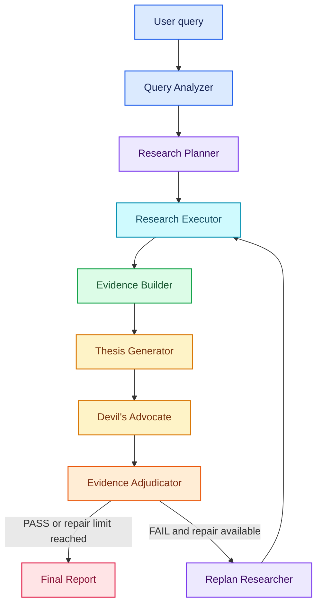

# Agent Layer

The `src/agents/` package implements QuantPilot's research reasoning pipeline. Its agents transform a validated user request into a structured research plan, execute and assess evidence, synthesize and challenge a thesis, adjudicate evidence sufficiency, and assemble the final report.

The agents are coordinated by `src/graph/workflow.py`; they do not independently control the overall workflow. They exchange typed objects defined in `src/schemas/` and invoke models through the shared `src/llm/` gateway where LLM reasoning is required.

## Position in the system

The graph controls the conditional transition after adjudication. The replan path is bounded by the workflow's configured replan limit; the agent layer supplies the plan and evidence-related outputs used by that routing logic.

## Agent inventory

| Module | Main function | Responsibility |
|---|---|---|
| `query_analyzer.py` | `analyze_query_with_context(...)` | Interpret task types, entities, research questions and analysis dates |
| `research_planner.py` | `create_research_plan(research_query)` | Convert detected task types into initial research steps |
| `research_executor.py` | `execute_research_plan(...)` | Execute MCP tools and reuse eligible results from prior execution state |
| `evidence_builder.py` | `build_evidence_ledger(...)` | Convert tool outputs into evidence items and assess their support |
| `thesis_generator.py` | `generate_thesis(user_query, evidence)` | Synthesize an evidence-grounded thesis |
| `devils_advocate.py` | `critique_thesis(...)` | Identify missing, weak, challenged or conflicting evidence |
| `evidence_adjudicator.py` | `adjudicate_evidence(...)` | Determine evidence sufficiency and construct evidence debt |
| `replan_researcher.py` | `replan_research(...)` | Translate evidence debt into a targeted repair plan and additional financial metrics |
| `final_report.py` | `generate_final_report(...)` | Align and normalize execution results and construct the final report |

## 1. Query analysis and initial planning

### Query Analyzer

`analyze_query_with_context` combines deterministic heuristic extraction with an LLM-assisted interpretation. The heuristic identifies candidate task types, ticker-like entities, metric keywords and a basic time-horizon expression. The contextual path asks the reasoning model to identify task types, entities, answerable research questions and date status, then validates the returned structure.

Temporal interpretation supports explicit date ranges and relative durations through the contextual prompt. Resolved dates are normalized to an inclusive start and exclusive end; an explicitly stated final day is converted to the following day. Ambiguous dates preserve caller-supplied defaults, while invalid explicit dates raise an error rather than being silently replaced.

The workflow's active contextual entry point is `analyze_query_with_context`. The separate compatibility function `analyze_query(query)` currently returns the heuristic interpretation only; it should not be confused with the richer workflow path.

### Research Planner

`create_research_plan` maps each detected task type to its initial tool categories using `TASK_TO_TOOLS`. It creates a separate `ResearchStep` for each task-type/tool-category pair, preserving the task association and assigning a category-specific objective.

The planner also contains `refine_objective`, an optional LLM-assisted objective refinement function with a deterministic default-objective fallback. The current `create_research_plan` implementation assigns the predefined `TOOL_OBJECTIVES`; it does not call `refine_objective` in the active plan-construction path.

Initial planning and repair planning deliberately use separate mappings: the initial planner expresses the normal research scope, while the replan researcher has a broader repair mapping.

## 2. Research execution and incremental reuse

`execute_research_plan` is asynchronous and invokes the MCP client for market, financial, quantitative and external-research operations.

Its execution behaviour includes several distinct reuse layers:

- **Inter-plan reuse:** `existing_results` supplied from workflow state lets a replan reuse suitable market, financial and quantitative results from the initial execution.
- **Intra-plan reuse:** `computed_results` stores the result already obtained for a tool category during the current execution call, so another step using that category can reuse it.
- **Incremental quantitative execution:** existing quantitative outputs are inspected by operation name; only missing calculations are requested, and new outputs are merged with retained outputs.
- **Incremental financial execution:** requested metrics are compared with metrics already present. Only missing metric names are sent to the financial MCP tool, and returned metrics are merged with prior metrics.
- **External research refresh:** the executor currently performs the research call for a research step rather than reusing `existing_research`; the earlier reuse branch is commented out. It then attempts to synthesize the returned sources into a bounded summary.

These are separate from the persistent MCP tool-result cache in `src/cache/` and from graph checkpointing. The executor's `computed_results` reuse is keyed by tool category, not by a SHA-256 content hash.

The research enhancement step uses the reasoning role to synthesize Tavily source titles, URLs and content. It is instructed to preserve material facts, dates, caveats and disagreements, and to distinguish source publication/coverage dates from the requested market-analysis period. If synthesis fails, the original research result is retained.

## 3. Evidence construction and assessment

`build_evidence_ledger` converts each successful tool result into one or more `Evidence` records:

- Market output becomes an observation-count evidence item.
- Financial output becomes one item per metric with a non-null value.
- Quantitative output becomes items for total return, return-series coverage, volatility and maximum drawdown.
- External research output becomes source-linked evidence using the synthesized summary when available, otherwise the source content.

The builder then calls `assess_evidence_ledger`, which asks the judge-role model to assess each evidence item independently. The model response is parsed and checked against the permitted statuses and a 0–1 confidence range. If assessment fails, the original item is retained rather than discarded.

### Evidence-assessment reuse and duplicate handling

The builder uses `_assessment_key`, a SHA-256 hash over a canonical JSON payload containing the claim, source type, source and evidence text.

That key supports two forms of reuse:

1. **Prior-ledger reuse:** an identical evidence item can retain its earlier assessment when `previous_evidence` is supplied.
2. **Within-ledger reuse:** repeated identical evidence items in the current ledger can reuse the first assessment instead of invoking the judge again.

The key deliberately excludes task type, tool category and step ID. This lets the same underlying evidence retain one assessment when it appears under different task associations. It is exact-content reuse, not semantic duplicate detection: differently worded evidence about the same underlying fact may still be assessed separately.

## 4. Thesis, critique and adjudication

### Thesis Generator

`generate_thesis` synthesizes the user query and evidence ledger through the judge-role model. It derives the supporting and contradicting evidence lists deterministically from evidence statuses, rather than asking the model to reconstruct those lists. Its prompt instructs the model to avoid unsupported comparisons and to treat repeated copies of the same underlying evidence as one fact.

If there is no evidence, or if model output cannot be parsed and validated, the function returns a deterministic fallback thesis with a conservative confidence value.

### Devil's Advocate

`critique_thesis` identifies missing evidence by comparing the task-type/tool-category combinations required by the repair mapping with those represented in the evidence ledger. It also challenges unsupported, partially supported, conflicting and unverified items, low-confidence evidence, and potentially overconfident theses with too little support.

The judge-role model produces a concise critique; deterministic fallback text is used if generation or validation fails. Duplicate challenge strings are removed before the `Critique` is returned.

The function also receives `replan_count` and `replan_financial_metrics` to account for the special financial-tool cases created by incremental metric handling.

### Evidence Adjudicator

`adjudicate_evidence` combines thesis support, critique findings and the evidence ledger. Missing and challenged evidence are consolidated into `evidence_debt`. The presence of unresolved debt leads to a deterministic FAIL fallback; otherwise, available evidence can support a PASS fallback. A separate research-quality calculation produces a quality score and band.

The judge-role model may refine the rationale and confidence, but the structured decision and evidence-debt logic are established before that generation step. The graph uses the adjudication decision and replan count to select the next workflow path.

A PASS means the workflow's evidence-sufficiency criteria were met; it is not an independent guarantee that every claim is factually correct.

## 5. Targeted replanning

`replan_research` converts adjudication evidence debt into repair steps. It handles both explicit missing-evidence entries, which identify a task type and tool category, and challenged-evidence entries, which are mapped back to the corresponding evidence item.

The function:

- Uses `REPLAN_TASK_TO_TOOLS`, separate from the initial planner mapping.
- Avoids duplicate task-type/tool-category pairs in a single repair plan.
- Ignores debt that cannot be mapped to a supported task/tool combination.
- Derives additional financial metric names from the original query using the supported Yahoo Finance information-field set.
- Marks a financial repair step optional when no dynamic financial metric is identified, allowing the executor to skip that optional operation instead of failing solely because the replan has no financial metrics.

The executor can then reuse suitable initial results, retrieve only missing financial metrics, compute missing quantitative outputs and refresh external research where the repair plan requests it. This is evidence-directed incremental repair rather than an unconditional replay of the entire initial plan.

Financial-metric corner cases are intentionally summarized here; the detailed permutations are part of the executor/replan implementation and its tests rather than a separate long narrative in this README.

## 6. Final report assembly

`generate_final_report` receives the user query, initial and replan plans/results, thesis and adjudication, together with the initial and replan financial-metric selections.

Before constructing the report, the module:

- Splits the consolidated execution results into initial and replan batches by detecting the step-ID reset.
- Aligns each batch against its corresponding plan and verifies step ID, task type and tool category.
- Identifies successful outputs.
- Normalizes results by tool category while preserving their task-type associations and initial/replan provenance.
- Handles financial metrics across initial and replan execution so the final normalized output reflects the combined result set.
- Builds the report's summary, thesis, conclusion, confidence, normalized results, limitations and validation remarks.

The summary and conclusion may be refined by the reasoning-role model. If generation or validation fails, the module retains deterministic input-based narrative fallbacks. The report schema is defined in `src/schemas/final_report.py`.

## LLM and failure-handling pattern

The agents use the shared `invoke_with_fallback` gateway with role selection appropriate to the task: reasoning for query interpretation, research-summary synthesis and report narrative; judge for evidence assessment, thesis, critique and adjudication.

LLM-generated structured responses are parsed and validated in the agent function. Where a deterministic fallback is defined, provider errors, malformed JSON or invalid fields do not automatically erase the workflow's available result. This fallback behaviour is function-specific; it should not be interpreted as every agent being able to recover from every tool or execution failure.

## Related components

- [`../schemas/README.md`](../schemas/README.md) — Pydantic contracts exchanged by the agents.
- [`../tools/README.md`](../tools/README.md) — market, financial, quantitative and research operations.
- [`../mcp/README.md`](../mcp/README.md) — protocol client and server layer used by the executor.
- `../llm/` — model roles, provider integration, routing and fallback.
- `../graph/` — workflow state, node orchestration, conditional routing and checkpointing.
