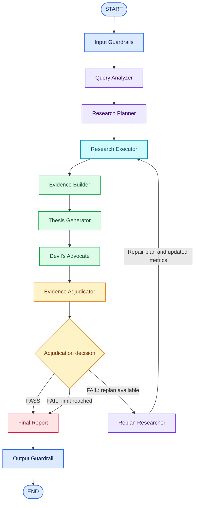
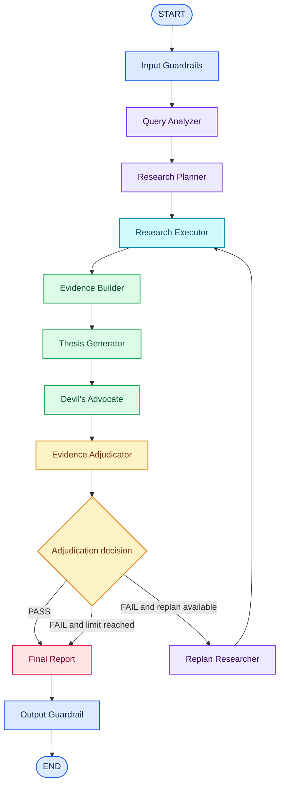

# Graph and Workflow Orchestration

The `src/graph/` package is QuantPilot's central orchestration layer. It connects input validation, query interpretation, research planning, tool execution, evidence assessment, thesis generation, critique, adjudication, bounded replanning and final-report validation into a single LangGraph workflow.

The graph coordinates the agents and infrastructure components without embedding their underlying research or reasoning logic. Shared state is defined through `QuantPilotState`, while individual nodes invoke the corresponding modules under `src/agents/`, `src/guardrails/` and `src/mcp/`.

## 1. System architecture





The diagram represents the component relationships. The detailed execution sequence and conditional routing are defined by `workflow.py`.

## 2. Core files

| File | Responsibility |
|---|---|
| `state.py` | Defines `QuantPilotState`, the shared TypedDict state schema |
| `workflow.py` | Defines workflow nodes, execution order, conditional edges, checkpointing and node logging |
| `__init__.py` | Package initialization |

## 3. Shared workflow state

`QuantPilotState` is implemented as a `TypedDict`, rather than a Pydantic model. This is intentional: LangGraph passes and updates shared state between nodes, and TypedDict provides a suitable state-schema interface.

The state distinguishes required initial inputs from fields generated during execution.

### Required initial inputs

- `user_query`: original user request.
- `ticker`: target security.
- `start`: analysis-period start date.
- `end`: analysis-period end date.

### Optional initial input

- `financial_metrics`: explicitly requested financial metrics.

### Generated workflow state

| State field | Generated by | Purpose |
|---|---|---|
| `research_query` | Query Analyzer | Structured interpretation of the request |
| `research_plan` | Research Planner | Initial research plan |
| `research_results` | Research Executor | Consolidated execution results |
| `evidence` | Evidence Builder | Evidence ledger |
| `thesis` | Thesis Generator | Evidence-grounded thesis |
| `critique` | Devil's Advocate | Critique and evidence challenges |
| `adjudication` | Evidence Adjudicator | PASS/FAIL evidence decision |
| `replan_plan` | Replan node | Targeted repair plan |
| `replan_financial_metrics` | Replan node | Additional financial metrics |
| `replan_count` | Replan node | Number of repair attempts |
| `final_report` | Final Report node | Structured final report |

Fields that are not present at workflow initialization are declared with `NotRequired`. They become available as the corresponding nodes populate the state.

This separates the initial request from progressively generated research information and avoids requiring every intermediate value to exist before graph execution.

## 4. Workflow lifecycle

The graph is built using LangGraph's `StateGraph` and connects the following nodes.



### Node responsibilities and sequence

| Order | Node | Operation |
|---:|---|---|
| 1 | `input_guardrails` | Validate query, redact supported PII and verify research scope |
| 2 | `query_analyzer` | Interpret the query and resolve its analysis period |
| 3 | `research_planner` | Generate the initial research plan |
| 4 | `research_executor` | Execute the selected tools through MCP |
| 5 | `evidence_builder` | Build and assess the evidence ledger |
| 6 | `thesis` | Generate the research thesis |
| 7 | `devil_advocate` | Challenge the thesis and identify evidence gaps |
| 8 | `evidence_adjudicator` | Determine whether evidence is sufficient |
| 9 | `replan` (conditional) | Generate targeted additional research when required |
| 10 | `final_report` | Align results and generate the structured report |
| 11 | `output_guardrail` | Perform final-report validation and contextual review |

The graph's node functions are deliberately thin orchestration adapters. Research logic remains in the corresponding agent modules.

## 5. Conditional routing and bounded replanning

The key routing function is `route_after_adjudication(state)`.

It evaluates the adjudication result and the current replan count.

The configured limit is:

```python
MAX_REPLANS = 1
```

The routing rules are:

1. `PASS` routes directly to `final_report`.
2. `FAIL` routes to `replan` when the current count is below `MAX_REPLANS`.
3. `FAIL` routes to `final_report` when the maximum repair count has been reached.

The replan node calls `replan_research()` with the structured research query, evidence ledger and adjudication result. It stores the resulting `replan_plan` and `replan_financial_metrics`, and increments `replan_count`.

The graph then returns to `research_executor`, not to the initial planner.

### Why the repair loop matters

The replan path is not an unconditional retry of the original plan. It uses evidence debt and challenged evidence to identify additional research requirements.

The executor receives the existing results from workflow state and can reuse suitable outputs while retrieving missing information. This supports incremental repair rather than restarting the complete research process.

The initial planner and repair planner also have separate task-to-tool mappings, allowing repair to use a broader set of relevant tool categories.

The bounded loop prevents repeated adjudication failures from creating an uncontrolled execution cycle.

## 6. Incremental state and result reuse

The graph maintains a consolidated `research_results` list across initial execution and replanning.

The research executor receives:

- The active plan (`replan_plan` when present, otherwise `research_plan`).
- Initial and additional financial-metric selections.
- Existing results from workflow state.
- The current `replan_count`.

New execution results are appended to the existing state results.

The Evidence Builder receives the previous evidence ledger through `previous_evidence`, allowing identical evidence assessments to be reused where the evidence-assessment key matches.

These mechanisms should be distinguished from graph checkpointing and persistent tool-result caching:

| Mechanism | Responsibility |
|---|---|
| Workflow state reuse | Retain earlier results between initial execution and replanning |
| Executor in-run reuse | Avoid repeating eligible work during the current execution |
| Evidence-assessment reuse | Reuse assessments for identical evidence content |
| Persistent tool-result cache | Reuse eligible tool results across calls/runs |
| Graph checkpointing | Persist workflow state through LangGraph's checkpointer |

The graph coordinates these mechanisms but does not implement all their caching logic itself.

## 7. Graph checkpointing and persistence

`build_quantpilot_graph(checkpointer=None)` accepts an optional checkpointer and passes it to `graph.compile()`.

The module also provides the asynchronous context manager:

```python
compiled_quantpilot_graph()
```

It initializes `AsyncSqliteSaver` using:

```text
data/quantpilot_checkpoints.sqlite3
```

The context manager yields a compiled graph with the SQLite checkpointer attached.

This separates graph construction from checkpoint lifecycle management and allows the workflow to be used with or without an explicitly supplied checkpointer.

Checkpointing persists LangGraph execution state according to the configured saver and invocation configuration. It is distinct from tool caching: a checkpoint preserves graph state, whereas a tool cache reuses eligible operation results.

## 8. Node logging and execution observability

The workflow uses:

```python
logger = logging.getLogger("quantpilot.workflow")
```

Each node is registered through the `_logged_node()` wrapper.

Three helper functions implement the logging behaviour:

| Function | Responsibility |
|---|---|
| `_logged_async_node()` | Wraps asynchronous node functions |
| `_logged_sync_node()` | Wraps synchronous node functions |
| `_logged_node()` | Detects the node function type and selects the appropriate wrapper |

Both wrappers preserve the original node metadata through `functools.wraps`.

They record:

- Node start.
- Successful completion.
- Node execution duration.
- Exceptions and traceback information when a node fails.

Execution duration is measured with `perf_counter()`.

The wrapper allows synchronous and asynchronous nodes to share the same logging convention without changing their underlying implementation.

For sequential evaluation, the workflow logger can propagate to a root/file handler configured by the evaluation runner. This allows workflow-level and module-level logs to be collected in a common evaluation log without renaming the existing loggers.

## 9. Guardrail integration

The graph integrates input and output validation at separate boundaries.

### Input boundary

`input_guardrails_node` performs the following operations:

1. Validates query presence and length.
2. Redacts supported PII using `redact_pii()`.
3. Validates research scope.
4. Returns the sanitized query into workflow state.

These checks occur before query analysis and research execution.

### Output boundary

`output_guardrail_node` obtains the generated `FinalReport`, calls `validate_final_report()` and writes the validated report back into state.

This occurs after final-report generation and immediately before `END`.

The output review does not rewrite the report. If contextual verification cannot be completed, the report can retain an explicit `UNVERIFIED` validation remark.

## 10. Error handling and execution boundaries

The workflow nodes validate the presence of essential state fields before invoking downstream operations. Missing required state raises an explicit exception rather than silently substituting an empty value.

The logging wrappers record node failures and re-raise exceptions. They do not swallow execution errors or convert every failure into a successful report.

Some agent-level functions provide their own deterministic fallbacks for LLM generation or parsing failures. Those behaviours belong to the agent implementations, not to a universal graph-level exception handler.

Input-scope rejection and output-review uncertainty also have different outcomes: scope rejection stops the research workflow, whereas contextual output-review failure can leave a generated report marked `UNVERIFIED`.

## 11. Design principles

- **Centralized orchestration:** the graph defines execution order and conditional transitions while agents retain their domain logic.
- **Typed shared state:** `QuantPilotState` makes required inputs and generated fields explicit.
- **Bounded recovery:** evidence-driven replanning is limited by `MAX_REPLANS`.
- **Incremental execution:** the graph preserves prior results and passes them into repair execution.
- **Layered validation:** input and output guardrails operate at opposite ends of the workflow.
- **Checkpoint support:** SQLite persistence is integrated through LangGraph's checkpointer interface.
- **Unified observability:** synchronous and asynchronous nodes share a consistent logging wrapper.
- **Separation of concerns:** graph state, tool caching, evidence reuse and model invocation remain distinct responsibilities.

## Related components

- [`../agents/README.md`](../agents/README.md) — research planning, execution, evidence processing and report generation.
- [`../guardrails/README.md`](../guardrails/README.md) — input, PII and output validation.
- [`../schemas/README.md`](../schemas/README.md) — structured state and agent data contracts.
- [`../mcp/README.md`](../mcp/README.md) — MCP client/server integration.
- [`../tools/README.md`](../tools/README.md) — underlying market, financial, quantitative and research operations.
- `../llm/` — model roles, provider selection, routing and fallback.
- `../cache/` — persistent tool-result cache.
