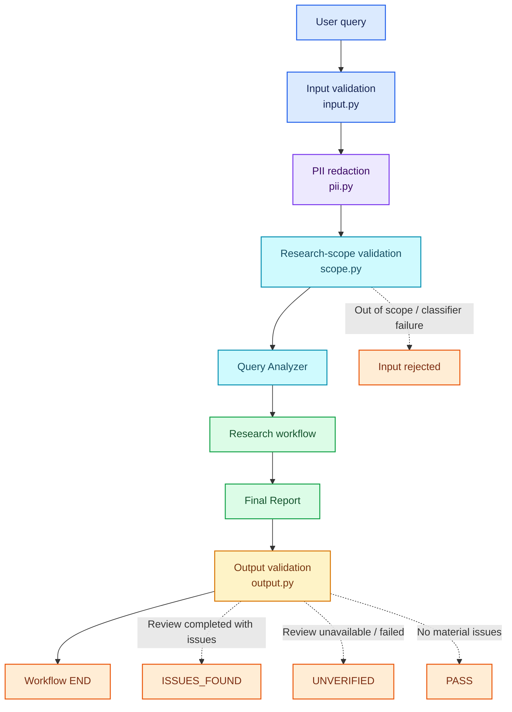

# Guardrails Layer

The `src/guardrails/` package provides input validation, research-scope enforcement, deterministic PII/confidential-content redaction and final-report review. It establishes validation boundaries around QuantPilot's research workflow while allowing valid reports to survive failures in the contextual output-review stage.

## Position in the workflow



The graph integration is implemented in `src/graph/workflow.py`. Input guardrails execute before query analysis, while output validation runs after final-report generation and before the workflow ends.

## Module inventory

| Module | Main interface | Responsibility |
|---|---|---|
| `input.py` | `UserQuery`, `validate_user_query()` | Trim and validate query presence and length |
| `scope.py` | `ResearchScope`, `validate_research_scope()` | Determine whether a query falls within QuantPilot's supported research domain |
| `scope.py` | `classify_research_scope()` | Use the guardrail-role LLM when keyword matching cannot establish scope |
| `pii.py` | `redact_pii()` | Deterministically redact supported identifiers and explicitly labelled confidential content |
| `pii.py` | `build_langchain_pii_middleware()` | Construct reusable LangChain PII middleware |
| `output.py` | `OutputReview`, `parse_output_review()` | Parse structured contextual-review findings |
| `output.py` | `validate_final_report()` | Validate report structure and review report consistency |

## 1. Input validation

`validate_user_query()` strips leading and trailing whitespace and validates the result through the Pydantic `UserQuery` model.

The model enforces:

- Minimum query length: 5 characters.
- Maximum query length: 2,000 characters.
- Non-empty content after trimming.

Empty queries raise an explicit `ValueError`; length violations are enforced by Pydantic validation.

This is a deterministic validation step. It does not assess whether the query is financially relevant or answerable.

## 2. Research-scope validation

`validate_research_scope()` determines whether the query belongs to QuantPilot's financial, company, market, investment, economic or quantitative research domain.

It uses a two-stage approach:

1. **Keyword matching:** extracts words using regular expressions and checks them against `RESEARCH_KEYWORDS`.
2. **LLM-assisted classification:** if there is no keyword overlap, invokes the `guardrail` model role through `invoke_with_fallback()` and validates the returned JSON using `ScopeDecision`.

The keyword set covers concepts such as equities, stocks, valuation, earnings, returns, volatility, drawdown, portfolios, ETFs, macroeconomics, bonds, commodities and currencies.

The LLM classifier treats the query as data rather than instructions and returns a Boolean `in_scope` decision.

### Scope decision behaviour

- Keyword match: accepts the query without an LLM classification call.
- No keyword match and classifier accepts: accepts with a semantic-classification reason.
- No keyword match and classifier rejects: raises an out-of-scope `ValueError`.
- Classifier exception or invalid response: raises an explicit scope-verification `ValueError`.

A classifier failure therefore does not silently turn an uncertain query into an accepted query.

**Limitation:** keyword matching can produce false positives and false negatives. The semantic classifier supplements the heuristic rather than replacing it.

## 3. PII and confidential-content protection

`redact_pii()` performs deterministic, regex-based redaction before the query proceeds to downstream reasoning.

Its supported patterns include:

- Labelled Aadhaar identifiers.
- Tax and business-registration identifiers, including GSTIN, CIN, EIN, VAT and related registration formats.
- Certificate and certification references.
- Patent, trademark, copyright and industrial-design registration references.
- Explicitly labelled confidential or proprietary information.
- Recognizable identifier formats including GSTIN, CIN, EIN, email addresses, Indian phone numbers and PAN.

The implementation deliberately avoids redacting arbitrary 12-digit numbers as Aadhaar identifiers: the Aadhaar pattern requires an explicit label. Similarly, confidential-content redaction requires an explicit confidential/proprietary label and is bounded to the same line, stopping at a comma or semicolon.

Recognized identifiers are replaced with type-specific placeholders, while labelled registration and reference identifiers retain their label with an `[IDENTIFIER REDACTED]` value.

### LangChain PII middleware factory

`build_langchain_pii_middleware()` constructs reusable `PIIMiddleware` instances for:

- Built-in email, credit-card, IP and MAC-address detectors.
- The custom identifier and confidential-content patterns defined in `pii.py`.

The factory supports configurable output and tool-result checks. It requires a compatible LangChain version.

**Integration distinction:** the current graph's input node directly calls `redact_pii()` before scope validation and query analysis. The middleware factory is available for compatible LangChain agents; it does not automatically protect custom graph nodes or direct LLM calls. Its existence should not be interpreted as proof that every model invocation or tool result is currently covered by middleware.

## 4. Output validation and contextual review

`validate_final_report()` performs two layers of validation.

### Deterministic checks

First, it ensures that the supplied object conforms to `FinalReport` and verifies that:

- `user_query`, `summary`, `thesis` and `conclusion` are non-empty.
- `normalized_results` contains dictionaries.

Schema constraints such as confidence bounds are enforced by the `FinalReport` Pydantic model.

### Contextual LLM review

The report is then submitted to the `guardrail` model role for a consistency and reliability review.

The review checks for:

- Material unsupported claims.
- Contradictions between report sections.
- Unjustified confidence.
- Limitations that undermine conclusions.
- Inconsistency between the thesis and conclusion.

The model is instructed to review the report without rewriting it. Its response is parsed into the `OutputReview` model, which contains an `issues` list.

The prompt also imposes a concise output bound of 256 tokens.

### Output-review outcomes

| Outcome | `validation_remarks` | Meaning |
|---|---|---|
| No material issues | `PASS: No material issues found.` | Contextual review completed without reporting material issues |
| Issues detected | `ISSUES_FOUND: ...` | Contextual review completed and returned one or more issues |
| Review not completed or failed | `UNVERIFIED: ...` | Contextual verification could not be completed |

The review parser extracts the JSON object from the response before validating it, accommodating responses that contain surrounding text or template tokens.

Importantly, an exception during contextual review does not discard an otherwise structurally valid final report. The report is returned with an `UNVERIFIED` remark.

`UNVERIFIED` is neither a PASS nor a confirmed violation. It records that contextual verification was not completed successfully.

## 5. Graph integration

The workflow connects the guardrails as follows:

- `input_guardrails_node` calls `validate_user_query()`, then `redact_pii()`, then `validate_research_scope()`.
- The validated and redacted query is returned to workflow state.
- Query analysis and the remaining research workflow execute afterward.
- `output_guardrail_node` obtains the generated `FinalReport` and passes it to `validate_final_report()`.
- The validated report is written back into workflow state before the graph ends.

The graph registers both nodes through its existing logging wrapper, preserving node-level execution logging.

The relevant graph edges are:

```text
START
  |
input_guardrails
  |
query_analyzer
  |
... research and report generation ...
  |
final_report
  |
output_guardrail
  |
END
```

Input validation and scope rejection can stop execution before expensive research and LLM processing. Output contextual-review failure, by contrast, is handled as an unverified review outcome rather than automatically invalidating the report.

## Design principles and limitations

- **Deterministic first:** query length, regex redaction and report structure checks do not require an LLM.
- **Selective semantic classification:** the scope LLM is invoked only when keyword matching finds no supported-domain term.
- **Privacy before reasoning:** the graph redacts supported PII from the user query before query analysis.
- **Fail-closed scope verification:** classifier failure does not silently accept an unverified query.
- **Non-destructive output review:** contextual review flags issues but does not rewrite the final report.
- **Graceful output-review failure:** a valid report can survive contextual-review failure with an explicit `UNVERIFIED` status.

These controls have defined coverage boundaries. Regex-based PII detection cannot guarantee detection of every sensitive identifier or confidential passage. Scope classification depends on the keyword set and the availability and reliability of the guardrail model. A contextual-review PASS indicates that no material issue was reported by the reviewer; it is not independent proof of factual correctness.

## Related components

- [`../agents/README.md`](../agents/README.md) — query interpretation, evidence reasoning, adjudication and report generation.
- [`../schemas/README.md`](../schemas/README.md) — Pydantic models used by input and output validation.
- `../llm/` — guardrail-role model invocation and provider fallback.
- `../graph/` — workflow integration, node logging and execution order.
