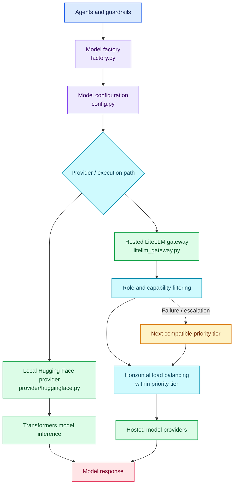
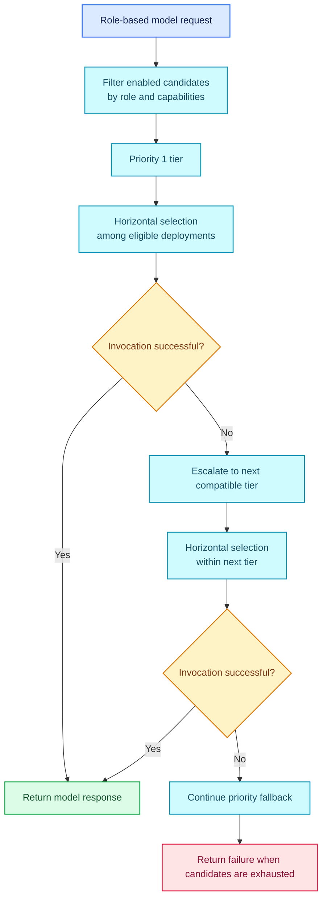

# LLM Infrastructure

The `src/llm/` package provides QuantPilot's model-invocation infrastructure. It separates model configuration, provider construction, local Hugging Face inference and hosted LiteLLM routing from the research agents that consume model outputs.

The design supports role-aware model selection, capability filtering, provider fallback and configurable model priorities. Agents request a model for a particular responsibility rather than depending directly on a specific provider or model identifier.

## Architecture

The diagram represents the architectural separation between local and hosted inference and the intended two-dimensional hosted-routing strategy. Exact routing behaviour depends on the active gateway implementation and its configuration.

## Module responsibilities

| Module | Responsibility |
|---|---|
| `config.py` | Model roles, provider/model candidates, capabilities, priorities, API-base resolution and role requirements |
| `factory.py` | Construct and expose model instances to agents through a shared invocation interface |
| `litellm_gateway.py` | Hosted-model routing and invocation through LiteLLM |
| `provider/huggingface.py` | Local Hugging Face model construction and inference |

## 1. Role-based model configuration

QuantPilot separates model selection by responsibility. The hosted configuration defines three roles:

| Role | Intended responsibility |
|---|---|
| `reasoning` | Query interpretation, research synthesis and report-oriented reasoning |
| `judge` | Evidence assessment, thesis synthesis, critique and adjudication |
| `guardrail` | Scope classification and contextual output review |

The configuration associates each role with compatible model candidates. A model configuration includes:

- Model and provider identifiers.
- LiteLLM model identifier for hosted inference.
- Maximum generation-token limit.
- Temperature.
- Capability declarations.
- Priority.
- API-key environment-variable name.
- Enabled/disabled state.
- Optional provider-specific API base.

Capabilities distinguish general text generation from reasoning, evaluation and structured instruction-following requirements. Candidate selection can therefore filter by role and required capabilities rather than relying only on model availability.

The local Hugging Face configuration is maintained separately from the hosted candidate list. This allows local inference and hosted inference to share the role-oriented configuration approach without treating them as identical execution paths.

## 2. Hosted model routing

The hosted configuration supports multiple model candidates per role and assigns them priority tiers.

Lower priority numbers represent earlier candidate tiers. Candidate selection considers whether a model is enabled and whether its declared capabilities satisfy the role requirements.

The configuration includes hosted candidates from providers such as Groq, NVIDIA, Google Gemini, Cloudflare and KiloCode. Provider-specific API bases and credentials are resolved through environment variables rather than hardcoded secrets.

### Two-dimensional routing

QuantPilot's routing design distinguishes two separate operations:

**Horizontal load balancing**

Select among compatible model deployments within the same priority tier. This distributes invocation attempts among eligible candidates without immediately escalating to a lower-priority tier.

**Vertical priority fallback**

When the current tier cannot provide a successful invocation, proceed to another compatible priority tier. This is a separate failure-escalation decision, not simply another load-balancing choice.

The gateway uses LiteLLM routing facilities to separate deployment selection from invocation failure handling. Router configuration and fallback behaviour should be interpreted together: a routing strategy controls selection within a deployment group, while the fallback sequence controls escalation between groups or priority tiers.

This separation is important because repeatedly trying unavailable or incompatible deployments within every tier can increase latency and consume provider limits. Candidate compatibility and failure handling therefore matter as much as the number of configured models.

## 3. Local Hugging Face inference

`provider/huggingface.py` provides the local model path using the Hugging Face ecosystem.

The local path is intended to support model execution without requiring every agent invocation to depend on an external hosted provider. Its configuration is separated from the hosted LiteLLM candidate list.

Local execution is subject to hardware and memory constraints. In particular, constrained environments such as Colab benefit from limiting the number of simultaneously resident model instances. Model loading, warm-up and workflow execution should be coordinated within the same active Python process where required by the runtime.

## 4. Model factory and invocation boundary

`factory.py` provides the construction boundary between agent functions and provider-specific model implementations.

The purpose of this boundary is to keep agent code independent of the underlying provider. Agents select a role and use the shared invocation path rather than embedding provider-specific API calls in each reasoning function.

The factory and gateway together provide the infrastructure for:

- Role-specific model selection.
- Hosted and local model construction.
- Capability-aware candidate filtering.
- Model invocation.
- Failure handling and fallback.
- Centralized model configuration.

The exact model lifecycle, response validation and fallback behaviour are defined by the active factory and gateway implementation.

## 5. Caching and execution efficiency

LLM response caching is a separate optimization from tool-result caching and graph checkpointing.

| Mechanism | What it reuses |
|---|---|
| LLM response cache | Eligible model responses for equivalent requests |
| Tool-result cache | Previously retrieved or calculated tool results |
| Evidence-assessment reuse | Earlier assessments of identical evidence content |
| Graph checkpointing | Persisted workflow state for checkpoint-based execution |

These mechanisms have different cache identities, lifecycles and purposes. They should not be treated as interchangeable.

An LLM response cache can reduce repeated model calls where the request is equivalent and the cache remains valid. It does not guarantee that different prompts, changed model configurations or changed provider responses will produce a cache hit.

## 6. Configuration and credentials

Hosted credentials are read through environment variables identified by each model configuration. Provider-specific API-base configuration is resolved centrally.

Typical provider credential names in the configuration include:

- `GROQ_API_KEY`
- `NVIDIA_API_KEY`
- `GOOGLE_API_KEY`
- `CLOUDFLARE_API_KEY`
- `KILOCODE_API_KEY`

Cloudflare additionally uses `CLOUDFLARE_ACCOUNT_ID` when constructing its account-specific API base.

Do not commit actual credentials, account secrets or `.env` files to the repository. Use an environment template containing variable names only.

## Design principles

- **Provider independence:** agents depend on a shared invocation interface rather than provider-specific implementations.
- **Role-aware selection:** reasoning, judging and guardrail responsibilities have distinct model requirements.
- **Capability filtering:** candidate selection considers declared capabilities as well as availability.
- **Two-dimensional routing:** horizontal load balancing is distinct from vertical priority escalation.
- **Local/hosted flexibility:** Hugging Face inference and hosted LiteLLM execution are maintained as separate provider paths.
- **Centralized configuration:** model candidates, priorities, capabilities and credentials are managed outside individual agent functions.
- **Failure-aware execution:** provider failures can be handled through configured fallback rather than requiring every agent to implement its own provider-selection logic.

## Limitations and operational considerations

- Declared model capabilities are configuration metadata; they do not independently prove that a provider model will reliably satisfy every task.
- Provider rate limits, token limits, model availability and API errors can affect fallback behaviour.
- A large candidate list does not automatically improve reliability if many candidates share provider limits or compatibility problems.
- Horizontal routing and vertical fallback must be configured carefully to avoid unnecessary repeated failures and latency.
- Local inference depends on available compute and memory; model residency strategy should match the execution environment.
- LLM response caching is not a substitute for evidence validation or factual verification.

## Related components

- [`../agents/README.md`](../agents/README.md) — model-consuming research agents and their role assignments.
- [`../guardrails/README.md`](../guardrails/README.md) — guardrail-role model usage.
- [`../schemas/README.md`](../schemas/README.md) — structured response contracts used by agents.
- `../graph/` — orchestration of model-consuming nodes and workflow state.
