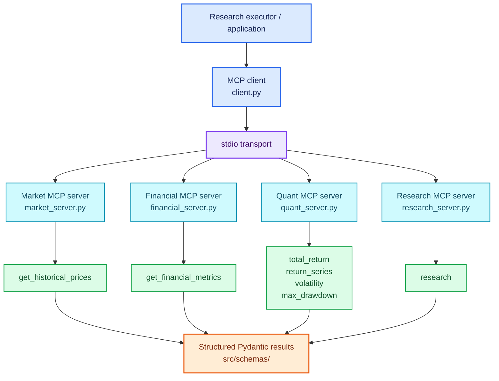

# MCP Integration Layer

The `src/mcp/` package exposes QuantPilot's market, financial, quantitative and external-research operations through the Model Context Protocol (MCP). It separates the tool implementations in `src/tools/` from the client-side execution interface used to discover and invoke them.

## Architecture



Each server is a separate Python module and exposes a small set of named MCP tools. The client launches the selected server as a subprocess using `python -m <module>`, establishes a standard-I/O connection, initializes an MCP `ClientSession`, and invokes the requested tool.

## Server modules and exposed tools

| Server module | MCP server name | Exposed tools | Underlying implementation |
|---|---|---|---|
| `market_server.py` | `QuantPilot Market Server` | `historical_prices` | `src.tools.market.get_historical_prices` |
| `financial_server.py` | `QuantPilot Financial Server` | `financial_metrics` | `src.tools.financials.get_financial_metrics` |
| `quant_server.py` | `QuantPilot Quant Server` | `total_return`, `return_series`, `volatility`, `max_drawdown` | `src.tools.quant` calculation functions |
| `research_server.py` | `QuantPilot Research Server` | `research_query` | `src.tools.research.research` |

The market server accepts a ticker and `date`-typed start/end values. The financial server accepts a ticker and a list of requested metric names. The quantitative server accepts schema-shaped market-price or return-series inputs, keeping calculations separate from market-data retrieval. The research server accepts a research sub-query, the original user query and a maximum-result parameter.

`src/mcp/__init__.py` re-exports the exposed tool functions for convenient imports.

## Client responsibilities

`client.py` provides two main operations:

- `connect_and_list_tools(module_name)` starts a server, initializes the MCP session and lists its available tools. This is useful for checking server discovery.
- `call_server(module_name, tool_name, arguments)` invokes a named tool and returns its parsed JSON result.

For a call, the client:

1. Checks the persistent tool-result cache, when available.
2. On a cache miss, launches the requested server module using `StdioServerParameters`.
3. Initializes an MCP `ClientSession` and calls the requested tool.
4. Raises an error if the MCP result reports failure or its first content item is not text.
5. Parses the text payload as JSON.
6. Caches the successfully parsed result and returns it.

MCP cache read/write failures are logged and do not prevent the client from attempting the normal tool call. The cache is lazily initialized through `get_tool_result_cache()` and uses `ToolResultCache` from `src/cache/tool_cache.py`. Cache identity is scoped by server module, tool name and arguments. Cache expiry and serialization behaviour are implemented in the cache module.

## Transport and process model

The current client-server path uses **stdio transport**. The client starts each server process on demand, so the server does not need to be launched separately beforehand. Server modules are executable with `python -m`, for example:

```bash
python -m src.mcp.market_server
```

The server modules call `mcp.run()`; the market and research servers explicitly select `transport="stdio"`, while the financial and quantitative servers use the SDK default. The client uses `stdio_client` and `ClientSession`.

The client contains commented scaffolding for a Streamable HTTP transport, but the active implementation is stdio. HTTP hosting should therefore not be presented as a currently enabled deployment mode.

## Structured data boundary

The MCP servers delegate to the underlying tool functions rather than duplicating data retrieval or quantitative logic. Market and quantitative inputs/outputs use Pydantic domain models from `src/schemas/`, including `HistoricalPrices` and `ReturnSeries`. The MCP SDK serializes tool results across the protocol boundary; the client parses the returned text representation into Python data.

This creates a clear separation:

- `src/tools/`: retrieval and calculation behaviour.
- `src/schemas/`: structured data contracts.
- `src/mcp/`: protocol exposure, discovery and remote-style invocation.

## Logging and diagnostics

The client logs cache hits, MCP call start/completion, duration and failures. Server stderr is directed to `quantpilot_mcp.log` by the client. The research server also prints request details and traceback information to its process output when research execution raises an exception.

The research server currently contains diagnostic `print` statements. These are useful during development but may need to be replaced with structured logging before production deployment.

## Usage example

```python
from src.mcp.client import call_server

result = await call_server(
    "src.mcp.market_server",
    "historical_prices",
    {
        "ticker": "MSFT",
        "start": "2025-01-01",
        "end": "2025-01-08",
    },
)
```

The call is asynchronous and must be awaited from an active event loop. The returned value is the parsed tool result, not the raw MCP `CallToolResult`.

## Scope and limitations

- The current client starts a separate server process for each cache-miss invocation; it does not maintain a long-lived pooled session in this implementation.
- Only the first content item is consumed, and it must be text containing JSON.
- Cache availability is optional: a cache initialization or read/write failure falls back to ordinary MCP execution.
- The active transport is stdio; the HTTP transport is only commented scaffolding.
- The research server includes diagnostic output that should be reviewed for quieter production operation.
- MCP exposes research and analytical tools; it does not provide autonomous trading or order execution.

For tool behaviour and calculation details, see [`../tools/README.md`](../tools/README.md). For the structured contracts crossing this boundary, see [`../schemas/README.md`](../schemas/README.md).
