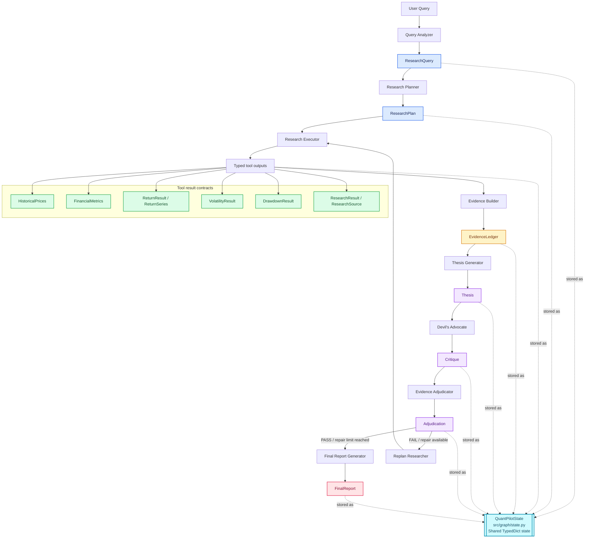

# Schema Layer

The `src/schemas/` package defines QuantPilot's typed data contracts using Pydantic `BaseModel`. These models give the tool, planning, evidence, reasoning and reporting layers shared structures for passing information through the research workflow.

## Role in the architecture



The diagram shows the conceptual progression, not a claim that every schema is instantiated by every query. The graph and agent implementations determine when each model is created and passed onward.

### Graph state and node-output linkage

`QuantPilotState` in `src/graph/state.py` is the shared TypedDict contract for the LangGraph workflow. It carries the required request inputs and the structured outputs produced as execution advances: `ResearchQuery`, `ResearchPlan`, tool results, `EvidenceLedger`, `Thesis`, `Critique`, `Adjudication` and `FinalReport`. Replanning metadata and optional financial-metric selections are also carried where applicable. These are typed state fields linking nodes; `QuantPilotState` is not a Pydantic wrapper around the individual output models. Generated fields remain optional until their producing node populates them.


## Model inventory

| Module | Models | Contract purpose |
|---|---|---|
| `market.py` | `PriceBar`, `HistoricalPrices` | Daily OHLCV observation and ticker-level historical price collection |
| `financials.py` | `FinancialMetric`, `FinancialMetrics` | Named financial metric, optional period and ticker-level metric collection |
| `quant.py` | `ReturnResult`, `ReturnPoint`, `ReturnSeries`, `VolatilityResult`, `DrawdownResult` | Structured total-return, periodic-return, volatility and drawdown outputs |
| `query.py` | `ResearchQuery` | Analyzed query: original text, task types, entities, questions, metrics and optional time horizon |
| `research.py` | `ResearchStep`, `ResearchPlan` | Planned research tasks, tool categories, objectives and required-step flags |
| `research.py` | `ResearchSource`, `ResearchResult` | External research source details and query-level result collection |
| `evidence.py` | `Evidence`, `EvidenceLedger` | Claim-linked evidence, provenance fields, source classification and assessment status |
| `thesis.py` | `Thesis` | Synthesized thesis, supporting/contradicting evidence and confidence |
| `critique.py` | `Critique` | Devil's Advocate critique, challenged/missing evidence and confidence |
| `adjudication.py` | `Adjudication` | PASS/FAIL decision, rationale, evidence debt, missing tool categories and quality assessment |
| `final_report.py` | `FinalReport` | User-facing report, normalized results, limitations and validation remarks |

## Important contract details

### Research planning

`ResearchQuery` represents the analyzer's structured interpretation of the user request. Its `task_types` are restricted to `market_analysis`, `financial_analysis`, `quantitative_analysis`, `comparison` and `mixed`.

`ResearchPlan` contains `ResearchStep` entries. Each step carries a `step_id`, task type, tool category (`market`, `financial`, `quantitative` or `research`), objective and `required` flag. This makes the planner's output explicit and consumable by the executor.

### Evidence and adjudication

`Evidence` records the claim, source type, source, task type, tool category, optional `step_id`, evidence text, confidence and status. Its source types distinguish market data, financial data, quantitative analysis and external research. Status values are `SUPPORTED`, `PARTIALLY_SUPPORTED`, `UNSUPPORTED`, `CONFLICTING` and `UNVERIFIED`.

`EvidenceLedger` is the collection of these items. `Adjudication` then records a `PASS` or `FAIL` decision, rationale, evidence debt, missing tool categories, confidence, quality score and quality band. This separates the evidence record from the decision about whether it is sufficient.

### Final report

`FinalReport` contains the original query, summary, thesis, conclusion, confidence, normalized results, limitations and `validation_remarks`. The latter defaults to an explicit unverified contextual-review message; it should not be interpreted as proof that contextual validation has occurred.

## Validation characteristics and caveats

Pydantic provides type validation and the constraints explicitly declared by each model. The schemas do not automatically establish factual correctness, source reliability, financial-data completeness or calibration of model-generated confidence.

A few implementation details are worth preserving:

- `Adjudication.decision` is constrained to `PASS` or `FAIL`; confidence and quality score are bounded from 0 to 1.
- `Adjudication.missing_tools` is restricted to the four supported tool categories.
- `Critique.confidence`, `Thesis.confidence` and `FinalReport.confidence` are bounded from 0 to 1.
- `Evidence.confidence` is currently a plain `float` without an explicit 0–1 field constraint.
- `PriceBar.date` and the `HistoricalPrices.start`/`end` fields use `datetime.date`; quantitative return-point and return-result dates are represented as strings.
- `FinancialMetric.value` deliberately permits numeric, string, boolean and `None` values, reflecting heterogeneous upstream financial fields.
- Several collections use `default_factory=list`, allowing empty lists without sharing mutable defaults between model instances.

These are current schema contracts, not guarantees that every upstream provider always supplies complete or comparable data.

## Public package interface

`src/schemas/__init__.py` re-exports the principal models, allowing callers to import from the package:

```python
from src.schemas import (
    HistoricalPrices,
    FinancialMetrics,
    ResearchQuery,
    ResearchPlan,
    EvidenceLedger,
    Adjudication,
    FinalReport,
)
```

The module-level definitions remain in their respective files, so domain contracts can be maintained independently while the package provides a convenient public import surface.

## Related components

- [`../tools/README.md`](../tools/README.md) — retrieval and calculation functions that produce tool-result models.
- [`../mcp/README.md`](../mcp/README.md) — MCP boundary through which tool inputs and outputs are exchanged.
- `../agents/` — planning, evidence assessment, thesis, critique, adjudication and report generation that consume these contracts.
- `../graph/` — workflow state and orchestration connecting the structured outputs.
