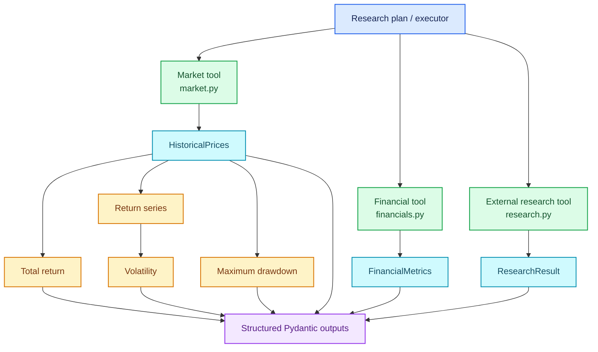

# Tools Layer

The `src/tools/` package provides QuantPilot's callable market, financial, quantitative and external-research operations. It keeps data retrieval and deterministic calculations behind small function interfaces, with structured results defined in `src/schemas/`.

## Responsibilities

| Module | Public operation | Responsibility | Upstream / input |
|---|---|---|---|
| `market.py` | `get_historical_prices(ticker, start, end)` | Retrieve daily OHLCV observations, including adjusted close | Yahoo Finance via `yfinance` |
| `financials.py` | `get_financial_metrics(ticker, metrics)` | Retrieve requested company and valuation metrics | Yahoo Finance via `yfinance` |
| `quant.py` | `calculate_total_return(prices)` | Calculate total adjusted-price return over the available observations | `HistoricalPrices` |
| `quant.py` | `calculate_return_series(prices)` | Calculate period-to-period adjusted returns | `HistoricalPrices` |
| `quant.py` | `calculate_volatility(returns, periods_per_year=252)` | Calculate annualized sample standard deviation of returns | `ReturnSeries` |
| `quant.py` | `calculate_max_drawdown(prices)` | Calculate the largest peak-to-trough decline | `HistoricalPrices` |
| `research.py` | `research(research_query, original_query, max_results)` | Retrieve external research evidence | Tavily-backed provider |

## Data flow and contracts



Tool outputs are structured using the corresponding Pydantic models in `src/schemas/`. The tools therefore return validated domain objects rather than unstructured dictionaries intended for downstream reasoning.

### Market data

`get_historical_prices` normalizes the ticker, validates the date range and retrieves daily OHLCV data. Its `start` date is inclusive and its `end` date is exclusive, following the upstream download interface. Empty data and invalid inputs raise `ValueError`; upstream retrieval exceptions may propagate from the provider.

The result includes the ticker, requested period and a list of `PriceBar` observations. Data availability and accuracy remain dependent on Yahoo Finance.

### Financial metrics

`get_financial_metrics` accepts an explicit list of metric names and returns one `FinancialMetric` entry per requested name inside `FinancialMetrics`. Values may be numeric, strings, booleans or `None`; unavailable fields are represented as `None` rather than silently omitted. The caller is responsible for specifying the metrics required for the research task.

### Quantitative calculations

The quantitative functions operate on previously retrieved, schema-validated market data; they do not independently fetch prices.

- Total return uses adjusted close at the first and last available observations.
- Return series uses consecutive adjusted-close observations.
- Volatility uses sample variance (Bessel's correction) and annualizes using the supplied number of periods per year (252 by default).
- Maximum drawdown tracks the running adjusted-close peak and the largest subsequent percentage decline.

The functions validate minimum observation counts. In particular, volatility requires at least two return observations, which in turn requires at least three price observations to produce two returns.

### External research

`research.py` delegates to `research_provider.py`, which uses Tavily. The search query combines the original user query with the research sub-query and financial/company context. The provider requests advanced search results and currently selects the highest Tavily-scored result for inclusion in `ResearchResult`.

This is a deliberately important distinction: although Tavily may return multiple search results, the current provider implementation retains the single highest-scored result in the structured response. The provider also emits diagnostic details about returned results during execution. Search relevance and source quality remain dependent on Tavily and the retrieved material; retrieval does not itself establish factual correctness.

## Registry and public imports

`registry.py` exposes the six market, financial and quantitative functions through the `TOOLS` list. The research operation is exported from the package's `__init__.py`, but is not currently included in that `TOOLS` list; it is exposed through the separate research integration path.

The package-level exports allow imports such as:

```python
from src.tools import get_historical_prices, get_financial_metrics
from src.tools import calculate_total_return, calculate_volatility
from src.tools import research
```

## Caching boundary

Tool-result caching is implemented separately under `src/cache/tool_cache.py`, not inside the individual tool modules. This separation keeps retrieval/calculation functions focused on their operations while allowing the execution layer to reuse eligible results. Cache keys, expiry and orchestration-level reuse should be understood alongside the cache and research-execution implementation rather than as behaviour guaranteed by each tool function.

## Dependencies and limitations

The current tool implementations use:

- `yfinance` for historical prices and financial information.
- `tavily-python` for external research retrieval.
- Pydantic schemas under `src/schemas/` for structured results.

These tools support research and analysis; they do not place trades or provide autonomous investment execution. Provider availability, data coverage, metric definitions and source quality can affect results. Quantitative outputs are calculations over the supplied observations and inherit the limitations of those inputs.
